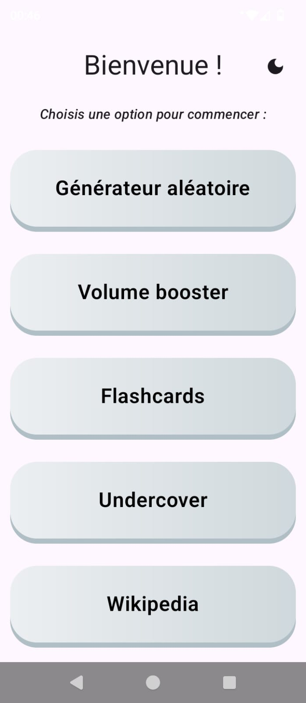
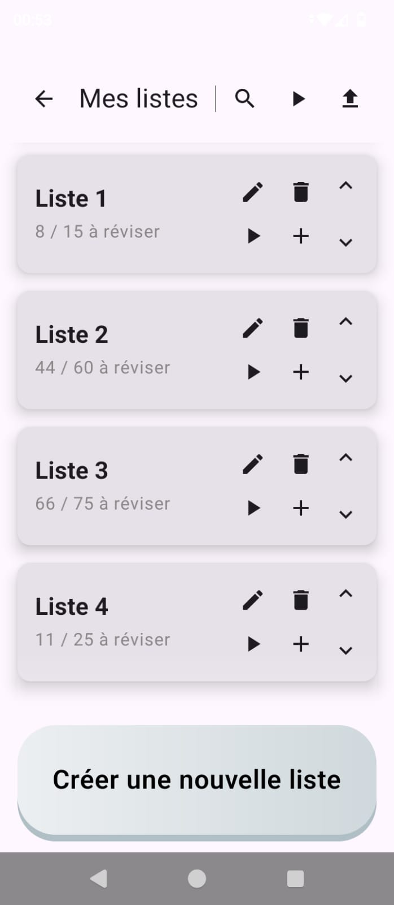
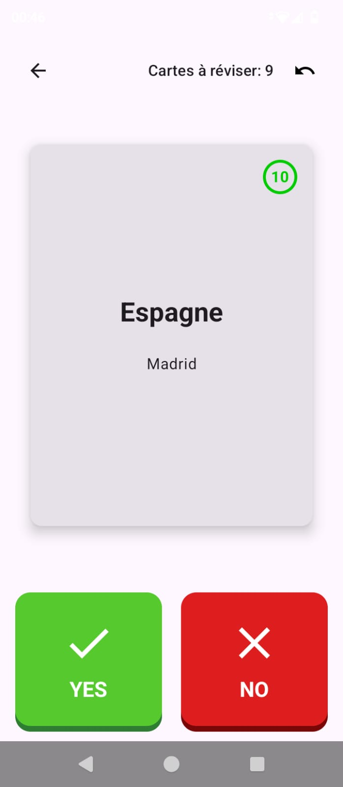

# CogniTools

An Android app built in Kotlin for **fun**, grouping all the little tools and games I like to have on my phone. Jetpack Compose throughout, sideloaded, single user. The UI is in English, except the Undercover game, which stays French, and the content that is French by nature (the French crossword grids, the flashcard decks, the French news).

<p align="center">
  
</p>

## Building and installing

From the command line, with a phone plugged in and USB debugging on:

`uv run --no-project src/deploy.py` runs all four steps below (`--no-build` reuses the last APK):

```bash
./gradlew assembleRelease
adb install -r app/build/outputs/apk/release/app-release.apk
adb shell am broadcast -a androidx.profileinstaller.action.INSTALL_PROFILE com.example.myapp/androidx.profileinstaller.ProfileInstallReceiver
adb shell cmd package compile -m speed-profile -f com.example.myapp
```

The last two lines install and apply the baseline profile shipped in the APK. Without them the app stays uncompiled until the phone's overnight idle job, about 25% slower on cold start.

Always install the release build: performance on device matters, and debug builds are noticeably slower. Debug is only useful for `run-as` access, e.g. inspecting the Room database.

## The tools

### Big ones

- **Notes**: checkbox and separator lines, a pinned Todo widget on the list, PIN lock per note, a 30 day trash, and a Courses/Ingrédients sync mode that keeps a shopping list and an ingredients list reconciled against their model notes.
- **Flashcards**: spaced repetition. The scheduler shows cards you know less often, so reviews concentrate on what is not yet learned. Cross-list stats, bulk import, and a filing dialog the translator and the crossword clue bar both write into.
- **Gallery**: a photo and video browser on top of MediaStore. Albums from your own folders, a full screen swipe viewer with pinch zoom and video playback, batch select by long press and drag, rename, move, share, crop, video trim, pinned pictures, albums lockable behind the notes PIN, and the system 30 day trash.
- **Music**: a Deezer streaming client (favorites, playlists, search, a daily "Today's discoveries" batch, an offline mirror of one playlist) and a podcast client (iTunes directory search, RSS subscriptions, downloads, listening progress, a sleep timer that pre-fetches the audio it needs so the night plays through offline) sharing one screen, with a mini player for each.

### Smaller ones

- **Calendar**: tasks, birthdays and events with their reminders, repeating tasks, the French public holidays and the Rennes school holidays.
- **Journal**: the daily newsletter written on the laptop by the daily-journal project, read and rated here, the ratings mailed back.
- **Workout**: guided sessions with rests, a boss round, XP levels and progress curves, an editable program, and a reminder two days after the last session, snoozable from its notification.
- **Recipes**: the recipe picked on the laptop from the Ingrédients note, with the missing ingredients marked, steps to tick, cooking timers, and the notes updated once cooked.
- **News**: French and world headlines merged from a fixed set of RSS feeds, readable in the app with the boilerplate stripped out, saved articles kept offline.
- **Crosswords**: arrow word grids (mots fléchés) generated on the phone, French or English, with a per word check and reveal. The dictionaries are built offline (see below).
- **Translate**: live translation with dictionary entries, text to speech, and a one tap "add to flashcards".
- **Reader**: an epub reader written against the format directly, no library. Long press a word to open the translator's lookup sheet. PDFs import here too and also open from the Files tool or any other app, drawn by the platform's PdfRenderer.
- **Weather**: forecast for your GPS location or a searched city, with temperature, conditions and rain amount.
- **Undercover**: the social deduction party game. Most players share a secret word, the *Undercover* have a different one and *Mr. White* has none. The ~80,000 word pairs were generated with NLP and FastText embeddings (see below).
- **Mail**: the Yahoo inbox over IMAP, fetched only when the screen opens. Read and delete, with the one time login code of a mail shown on its row and copied in one tap.
- **Files**: a plain file explorer, one folder at a time, with a remembered "open with" app per extension.
- **Wiki**: a random Wikipedia article.
- **Random**: random numbers and words.
- **Volume**: pushes the volume past the system limit.

<p align="center">
  
  
</p>

## Generating the assets

Three of the tools ship data generated offline by the Python scripts in `src/`. The project uses [uv](https://docs.astral.sh/uv/).

The Undercover word pairs:

```bash
uv sync
uv run python src/generate_pairs.py
```

`generate_dataset.ipynb` is a thin driver over the same module if you would rather inspect the results interactively:

```bash
uv sync --group notebook
uv run jupyter notebook generate_dataset.ipynb
```

The mots fléchés dictionaries and layouts, from Lexique and fr.wiktionary for French, wordfreq and WordNet for English. The French run scrapes fr.wiktionary into `data/motsfleches_senses.json`, which is not tracked: it takes a few minutes on a fresh clone and is resumable, so only rerun it when the dictionary itself needs rebuilding. `data/lexique.tsv` is a manual download from [lexique.org](http://www.lexique.org/) and is tracked, since nothing fetches it for you.

```bash
uv run --no-project src/generate_motsfleches.py
uv run --no-project --with nltk --with wordfreq src/generate_motsfleches_en.py
uv run --no-project src/generate_layouts.py
```

`--no-project` skips syncing the FastText and FAISS stack the word pairs need.

The Drapeaux flashcard list, every ISO country and territory flag from flagcdn with its French name, territories flying their sovereign's flag left out:

```bash
uv run python src/generate_flags.py
```

`--sheet <codes>` only renders those flags next to the shipped ones, as one image, without writing anything.

The Pays (carte), Départements (carte), Régions (carte) and Arrondissements (carte) lists, a locator map of every place in Drapeaux, of every French department and region and of every Paris arrondissement, from Natural Earth, france-geojson, Paris open data and OpenStreetMap (downloaded into `data/maps/`):

```bash
uv run --only-group maps src/generate_maps.py
```

`--sheet <codes>` renders those maps (ISO codes, department numbers like `35` or `2A`, region codes after an `r` like `r53`, or arrondissements after an `a` like `a7`) into `mockups/maps_sheet.png`, `--write <codes>` writes only their pictures, `--seeds` only the seed files, and `--pages` lists the atlas page each country lands on.

## Development

Lint and format run on commit through pre-commit, tests run on push:

```bash
uv run --with pre-commit pre-commit install
```

The JVM unit tests cover the pure logic (the Deezer stream decryption, the puzzle generator, the epub parser, the RSS extraction, the translation parsing, the spaced repetition scheduler, the calendar and workout schedules, the Todo list reminders, the verification code detection, the saved MP3 tagging, the Movies note episode bump). `-PskipPuzzleTests` leaves out the 2 minute generator test, as the pre-push hook does unless the generator changed:

```bash
./gradlew :app:testReleaseUnitTest -PskipPuzzleTests
```

Three scripts drive the app on the connected phone. `frame_stats.py` runs a fixed navigation journey and prints the janky frames per step, to compare two builds. `regenerate_profile.py` records the baseline profile (about 10 to 15 minutes, with the phone unlocked once the APKs are built), checks that every screen the journey opens made it into the profile, and sends any test note the journey left behind to the notes trash. `import_flashcards.py` pushes a flashcards JSON bundle to the app's external files folder and imports it through a broadcast only the adb shell can send, which replaces the cards it holds by id:

```bash
uv run --no-project src/frame_stats.py 3
uv run --no-project src/regenerate_profile.py
uv run --no-project src/import_flashcards.py corrections.json
```

`deezer_logs.py` pulls the music tool's logs off the phone into a temporary folder (or the one given) and groups the error and crossfade lines by kind, with counts, date ranges and the tracks Deezer refused on more than one day:

```bash
uv run --no-project src/deezer_logs.py
```

`mockup.py` renders HTML mockups to PNG in headless Firefox, at the phone's 360 dp width:

```bash
uv run --no-project src/mockup.py mockups/page.html --size 360,825
```

`workout_figures.py` draws every workout stick figure the way the app does, at the start, middle and end of its loop, into `mockups/workout_figures.png`:

```bash
uv run --no-project --with pillow python src/workout_figures.py
```

`CLAUDE.md` carries a one line per file map of the whole codebase, kept current as files are added or renamed.
